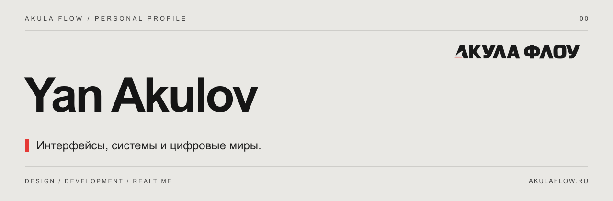

[Сайт](https://akulaflow.ru/) · [GitHub](https://github.com/yanakulov/yanakulov) · [GitVerse](https://gitverse.ru/yanakulov/yanakulov) · [Changelog](CHANGELOG.md)

# Ян Акулов

**UX/UI-дизайнер и разработчик веб-интерфейсов. Санкт-Петербург.**

Создаю интерфейсы, которые ощущаются как приложения: продумываю взаимодействия, собираю дизайн-системы и довожу визуальные идеи до работающего продукта.

Мой основной проект — **[Акула Флоу](https://akulaflow.ru/)**: дизайн, разработка и интерактивный веб. Внутри экосистемы развивается **Akula Net** — единая админка сайта с визуальным редактором, задачами, публикациями и аналитикой.

## Экосистема Акулы

| Продукт | Назначение | Репозитории |
|---|---|---|
| **aNet** | Единая админка и подключаемые модули | [GitHub](https://github.com/yanakulov/anet) · [GitVerse](https://gitverse.ru/yanakulov/anet) |
| **aCore** · Сердце Акулы | Страницы, пользователи, медиа и SEO — в одном интерфейсе. | [GitHub](https://github.com/yanakulov/acore) · [GitVerse](https://gitverse.ru/yanakulov/acore) |
| **aVision** · Глаза Акулы | Визуальное редактирование сайта через настоящие Vue-компоненты. | [GitHub](https://github.com/yanakulov/avision) · [GitVerse](https://gitverse.ru/yanakulov/avision) |
| **aFlow** · Поток Акулы | Проекты, доски, задачи и команда внутри aNet. | [GitHub](https://github.com/yanakulov/aflow) · [GitVerse](https://gitverse.ru/yanakulov/aflow) |
| **aJaws** · Пасть Акулы | Кросспостинг и расписание публикаций для Telegram и VK. | [GitHub](https://github.com/yanakulov/ajaws) · [GitVerse](https://gitverse.ru/yanakulov/ajaws) |
| **aSense** · Чутьё Акулы | Подробная аналитика, цели и поведение посетителей. | [GitHub](https://github.com/yanakulov/asense) · [GitVerse](https://gitverse.ru/yanakulov/asense) |

[Обзор AkulaFlow на GitHub](https://github.com/yanakulov/akulaflow) · [Обзор на GitVerse](https://gitverse.ru/yanakulov/akulaflow)

## Другие проекты

| Проект | О чём |
|---|---|
| [CRTDSP](https://github.com/yanakulov/crtdsp) | Звук старого CRT-телевизора и комнаты для RetroArch, с настройкой в реальном времени. |
| [Kyraweb](https://github.com/yanakulov/kyraweb) | Веб-реализация The Legend of Kyrandia на Vue и TypeScript. |
| [LOK Ripper](https://github.com/yanakulov/lokripper) | Инструменты с графическим интерфейсом для извлечения ресурсов The Legend of Kyrandia. |

## С чем работаю

**UX/UI · дизайн-системы · Vue · Nuxt · TypeScript · Node.js · PostgreSQL · интерактивный веб**

Публичные репозитории AkulaFlow содержат описания продуктов и changelog. Исходники экосистемы хранятся приватно.

---

**Flow creates further.**

[AkulaFlow](https://akulaflow.ru/) · [GitHub](https://github.com/yanakulov) · [GitVerse](https://gitverse.ru/yanakulov)
